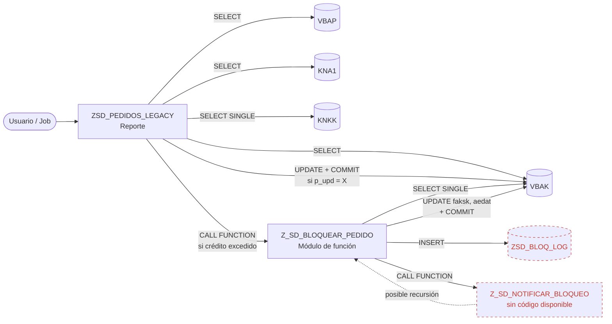
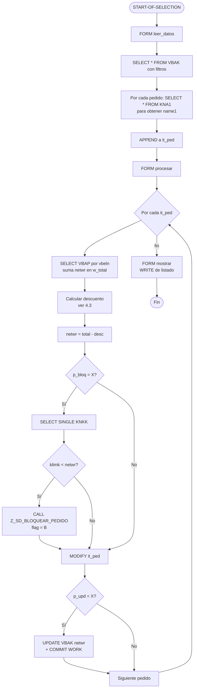
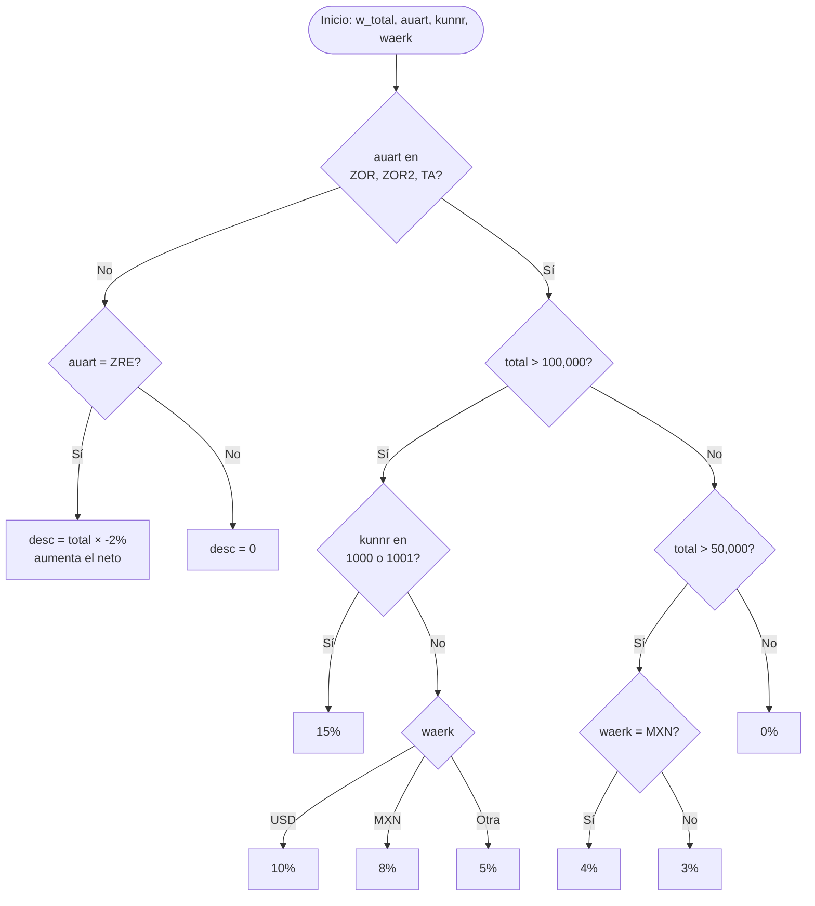
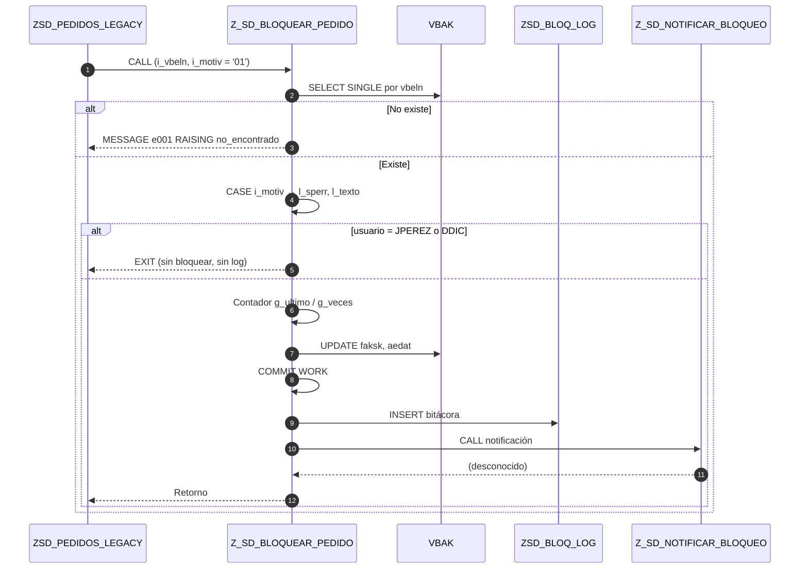
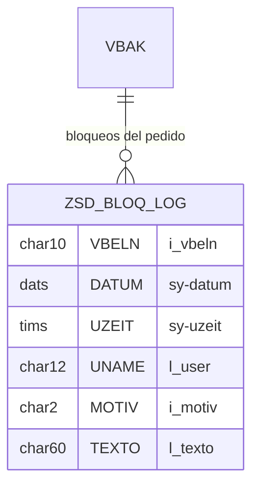
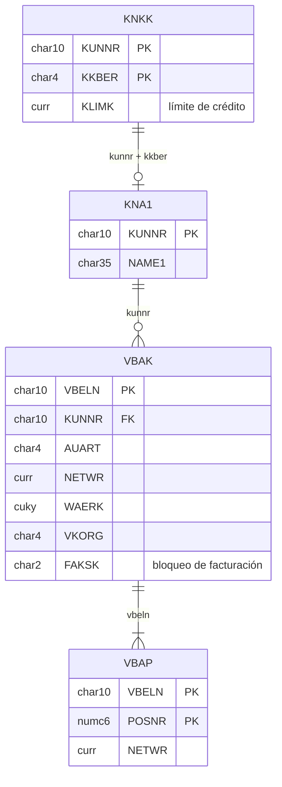

# Documento de entendimiento: módulos Z de pedidos y bloqueo de crédito

| Campo | Valor |
|---|---|
| Alcance | `ZSD_PEDIDOS_LEGACY` (reporte) y `Z_SD_BLOQUEAR_PEDIDO` (módulo de función) |
| Módulo SAP | SD (Ventas) con interacción FI-AR (crédito, tabla `KNKK`) |
| Propósito de este documento | Línea base de entendimiento **antes** de modernizar |
| Método | Lectura estática del código. **No se ejecutó nada en un sistema SAP.** |

Las afirmaciones marcadas como **[Hipótesis]** requieren confirmación en un sistema real.

---

## 1. Resumen ejecutivo

El reporte `ZSD_PEDIDOS_LEGACY` hace cuatro cosas:

1. Lee pedidos de venta (`VBAK`) según los filtros de selección.
2. Calcula un descuento por pedido con reglas hardcodeadas.
3. Valida el crédito del cliente. Si el neto supera el límite, llama al módulo de función `Z_SD_BLOQUEAR_PEDIDO`.
4. Opcionalmente **sobrescribe** `VBAK-NETWR` con el neto descontado y muestra un listado.

`Z_SD_BLOQUEAR_PEDIDO` pone un bloqueo de facturación (`VBAK-FAKSK`) al pedido, registra el bloqueo en una bitácora Z y llama a un módulo de notificación.

---

## 2. Inventario de objetos

| Objeto | Tipo | Archivo | Rol |
|---|---|---|---|
| `ZSD_PEDIDOS_LEGACY` | Reporte ejecutable | [`ZSD_PEDIDOS_LEGACY.abap`](ZSD_PEDIDOS_LEGACY.abap) | Orquestador: lectura, cálculo, crédito, salida |
| `Z_SD_BLOQUEAR_PEDIDO` | Módulo de función (grupo `ZSD_BLOQ`) | [`Z_SD_BLOQUEAR_PEDIDO.abap`](Z_SD_BLOQUEAR_PEDIDO.abap) | Bloqueo del pedido y bitácora |
| `Z_SD_NOTIFICAR_BLOQUEO` | Módulo de función | **No existe en el repo** | Notificación (comportamiento desconocido) |
| `ZSD_BLOQ_LOG` | Tabla Z | **No existe en el repo** | Bitácora de bloqueos (estructura inferida) |
| `ZSD` / mensaje `001` | Clase de mensajes | **No existe en el repo** | Texto del error "pedido no encontrado" |

### Tablas estándar SAP utilizadas

| Tabla | Descripción | Acceso |
|---|---|---|
| `VBAK` | Cabecera de pedido de venta | Lectura y **UPDATE** (reporte y FM) |
| `VBAP` | Posiciones de pedido | Lectura |
| `KNA1` | Maestro de clientes | Lectura |
| `KNKK` | Control de crédito del cliente | Lectura |
| `TVLV` | Declarada en el FM, no se usa | Ninguno |

---

## 3. Arquitectura y dependencias

Los objetos con borde punteado rojo no están en el repo, así que su comportamiento se desconoce.

---

## 4. Flujo del reporte

### 4.1 Pantalla de selección

| Parámetro | Tipo | Efecto |
|---|---|---|
| `s_vbeln` | Select-option | Rango de pedidos |
| `s_kunnr` | Select-option | Rango de clientes |
| `s_erdat` | Select-option | Rango de fecha de creación |
| `p_vkorg` | Parámetro (default `1000`) | Se usa como **área de control de crédito** (`KKBER`) en `KNKK` |
| `p_upd` | Checkbox | Si es `X`, hace `UPDATE vbak` y `COMMIT WORK` por pedido |
| `p_bloq` | Checkbox (default `X`) | Activa la validación de crédito y el bloqueo |

### 4.2 Flujo general

### 4.3 Reglas de descuento

Equivalente en tabla:

| Condición | Descuento |
|---|---|
| `auart` ∈ {ZOR, ZOR2, TA}, total > 100,000, cliente `0000001000` o `0000001001` | 15 % |
| ídem, otro cliente, `USD` | 10 % |
| ídem, otro cliente, `MXN` | 8 % |
| ídem, otro cliente, otra moneda | 5 % |
| `auart` ∈ {ZOR, ZOR2, TA}, 50,000 < total ≤ 100,000, `MXN` | 4 % |
| ídem, otra moneda | 3 % |
| `auart` ∈ {ZOR, ZOR2, TA}, total ≤ 50,000 | 0 % |
| `auart` = `ZRE` (devolución) | −2 % (el neto sube) |
| Cualquier otro tipo de documento | 0 % |

**Nota:** el código compara `w_total` directamente en la moneda del documento (`waerk`) con 100,000 y 50,000. No hay conversión de moneda. Un umbral de 100,000 vale muy distinto en USD que en MXN.

---

## 5. Flujo del módulo de función `Z_SD_BLOQUEAR_PEDIDO`

**Interfaz:**
- Entrada: `I_VBELN` (pedido) e `I_MOTIV` (motivo).
- Excepción: `NO_ENCONTRADO`.

### Tabla de motivos

| `i_motiv` | `FAKSK` asignado | Texto |
|---|---|---|
| `01` | `01` | Límite de crédito excedido |
| `02` | `02` | Cliente en cobranza |
| `03` | `10` | Revisión manual |
| Otro | vacío (sin `WHEN OTHERS`) | vacío |

Con un motivo no contemplado, el módulo ejecuta `UPDATE ... SET faksk = ''`. Eso **quita** el bloqueo en lugar de ponerlo.

### Estructura inferida de `ZSD_BLOQ_LOG`

Se deduce del orden de los valores en el `INSERT`.

La clave primaria es desconocida. **[Hipótesis]** Si fuera solo `VBELN`, un segundo bloqueo del mismo pedido provocaría un fallo de inserción duplicada que el código no valida.

---

## 6. Modelo de datos del reporte

---

## 7. Reglas de negocio detectadas

| ID | Regla | Ubicación |
|---|---|---|
| RN-01 | El neto del pedido es la suma de `VBAP-NETWR` menos el descuento calculado | Reporte, `procesar` |
| RN-02 | Descuentos por tipo de documento, monto, cliente y moneda (ver 4.3) | Reporte, `procesar` |
| RN-03 | Las devoluciones (`ZRE`) aplican un −2 % que aumenta el neto | Reporte, `procesar` |
| RN-04 | Se marca con `X` cuando el descuento supera el 12 % del total | Reporte, `procesar` (ver hallazgo H-06) |
| RN-05 | Si `KNKK-KLIMK` < neto final, se bloquea el pedido con motivo `01` | Reporte, `procesar` |
| RN-06 | `p_upd = X` sobrescribe `VBAK-NETWR` con el neto descontado | Reporte, `procesar` |
| RN-07 | Los usuarios `JPEREZ` y `DDIC` no sufren el bloqueo | FM, backdoor |
| RN-08 | Un pedido ya bloqueado más de 3 veces seguidas deja de bloquearse | FM, contador (ver hallazgo H-12) |
| RN-09 | Cada bloqueo se registra en `ZSD_BLOQ_LOG` y se notifica | FM |

---

## 8. Hallazgos y riesgos

**Severidad:** Alta = riesgo funcional, de integridad o de seguridad. Media = riesgo de rendimiento o mantenibilidad. Baja = deuda técnica.

### Reporte `ZSD_PEDIDOS_LEGACY`

| ID | Sev. | Línea | Hallazgo | Impacto |
|---|---|---|---|---|
| H-01 | Alta | 137-139 | `UPDATE vbak SET netwr` directo y `COMMIT WORK` dentro del loop | Sobrescribe el valor neto del pedido sin pasar por la lógica estándar de SD (pricing, estatus). Un fallo a mitad de camino deja datos parciales y no hay rollback global |
| H-02 | Alta | 71 | Sin `AUTHORITY-CHECK` | Cualquier usuario con acceso al reporte puede ver y modificar pedidos de cualquier organización de ventas |
| H-03 | Alta | 120-123 | Después del `SELECT SINGLE` a `KNKK` no se valida `sy-subrc`. Como `KNKK` está declarada con `TABLES`, la estructura conserva el registro del cliente anterior | Un cliente sin registro de crédito se evalúa con el límite del cliente anterior. Se puede bloquear o liberar un pedido por error |
| H-04 | Alta | 120-122 | `KKBER = p_vkorg` mezcla organización de ventas con área de control de crédito | Funciona solo si coinciden por casualidad |
| H-05 | Media | 56 | `SELECT * FROM kna1` dentro del `SELECT` de `VBAK` (N+1) | Rendimiento degradado con volumen |
| H-06 | Media | 110-111 | `w_tmp` es `c(20)` y recibe un cociente decimal, luego se compara con `'0.12'` | **[Hipótesis]** La comparación es de texto, no numérica. Con relleno de espacios a la izquierda la bandera `X` probablemente nunca se activa |
| H-07 | Baja | 110 | División `w_desc / w_total` sin validar cero | **[Hipótesis]** Con `w_total = 0`, `w_desc` también vale 0. El comportamiento de `0/0` en ABAP depende del tipo (puede dar 0 o `CX_SY_ZERODIVIDE`), por lo que hay que probarlo. Es riesgo latente si cambia la regla |
| H-08 | Media | 72 | `SELECT * FROM vbap` dentro del loop de pedidos, sin `FOR ALL ENTRIES` ni join | Segundo N+1 |
| H-09 | Media | 82-107 | `IF` anidados hasta 4 niveles, con clientes, tipos de documento, porcentajes y umbrales hardcodeados | Cualquier cambio comercial exige modificar código. Es alto riesgo de regresión |
| H-10 | Media | 82-107 | Umbrales sin conversión de moneda | Resultados comerciales inconsistentes entre USD y MXN |
| H-11 | Baja | 14-31 | Sintaxis obsoleta: `TABLES`, `OCCURS 0`, `HEADER LINE`, `LIKE`. Hay un campo llamado `desc` | No es compatible con el ABAP moderno ni con contextos de clase |

### Módulo de función `Z_SD_BLOQUEAR_PEDIDO`

| ID | Sev. | Línea | Hallazgo | Impacto |
|---|---|---|---|---|
| H-12 | Media | 19-20, 52-59 | `g_ultimo` y `g_veces` están declaradas con `DATA` **dentro** de `FUNCTION`, por lo que son **locales** y se reinician en cada llamada. El comentario original dice "globales", pero no lo son | La regla RN-08 es código muerto. `g_veces` siempre vale 1 y nunca llega a `> 3`. Para que funcionara tendrían que declararse en el `TOP include` del grupo |
| H-13 | Alta | 46-49 | Backdoor por nombre de usuario: `JPEREZ` y `DDIC` saltan el bloqueo | Control de seguridad eludible. Tampoco queda rastro en la bitácora |
| H-14 | Alta | 27 | Sin `ENQUEUE` sobre el pedido | Dos procesos pueden actualizar el mismo documento a la vez |
| H-15 | Alta | 63-68 | `UPDATE vbak` directo sin validar `sy-subrc` y con `COMMIT WORK` dentro del módulo | Rompe la unidad lógica de trabajo del llamador. Si el `COMMIT` ocurre dentro de un `LOOP` del reporte, no hay rollback posible |
| H-16 | Media | 33-43 | `CASE` sin `WHEN OTHERS` | Un motivo no previsto deja `l_sperr` vacío y **desbloquea** el pedido |
| H-17 | Media | 71-72 | `INSERT` a `ZSD_BLOQ_LOG` sin validar duplicados ni `sy-subrc` | Fallo silencioso. Se pierde la auditoría |
| H-18 | Media | 75-78 | Llamada a `Z_SD_NOTIFICAR_BLOQUEO`, de código desconocido | Si ese módulo vuelve a llamar a `Z_SD_BLOQUEAR_PEDIDO`, hay recursión indirecta. El contador de H-12, que no funciona, no la frena |
| H-19 | Media | 29 | `MESSAGE e001 ... RAISING no_encontrado` | El reporte **no declara** `EXCEPTIONS no_encontrado` en su `CALL FUNCTION` (línea 124). Sin esa declaración, el mensaje de error se emite de forma normal y el reporte termina a medias, en medio del loop. Los pedidos ya procesados con `p_upd = X` ya quedaron confirmados por el `COMMIT WORK` |
| H-20 | Baja | 15 | `TABLES: vbak, tvlv` en el FM. `tvlv` no se usa | Código muerto |

### Interacciones entre ambos objetos

- **Doble escritura sobre `VBAK`.** El reporte actualiza `NETWR` y el FM actualiza `FAKSK` y `AEDAT`. Cada uno hace su propio `COMMIT`, así que no hay atomicidad entre ambos.
- **Backdoor invisible para el reporte.** Si el FM sale por el backdoor, el reporte igual marca el pedido con `flag = 'B'` y lo muestra como `BLOQUEADO`, aunque no se haya bloqueado.
- **Sin control de errores del FM.** El reporte no pasa `EXCEPTIONS`, por lo que un pedido inexistente termina el programa con un mensaje de error en lugar de continuar con el siguiente pedido.

---

## 9. Lo que NO se pudo determinar

| Tema | Pregunta abierta |
|---|---|
| `Z_SD_NOTIFICAR_BLOQUEO` | ¿Qué hace? ¿Puede llamar de vuelta a `Z_SD_BLOQUEAR_PEDIDO`? |
| `ZSD_BLOQ_LOG` | Estructura real, clave primaria y tamaño del campo de usuario |
| Mensaje `ZSD 001` | Texto real del mensaje |
| Uso productivo | ¿Se ejecuta como job o manualmente? ¿Con `p_upd = X` en producción? |
| Descuento | ¿`VBAK-NETWR` se recalcula luego por pricing estándar y pisa lo que escribe el reporte? |
| Valores de `FAKSK` | ¿Los valores `01`, `02` y `10` existen en la configuración de motivos de bloqueo de facturación (`TVFS`)? |
| `p_vkorg` / `KKBER` | ¿El área de control de crédito coincide en la práctica con la organización de ventas? |
| Dependientes | ¿Qué otros programas, jobs o variantes llaman a estos objetos? |

---

## 10. Pruebas de caracterización sugeridas

Estas pruebas conviene definirlas **antes** de modernizar, para tener una referencia del comportamiento actual.

| # | Escenario | Resultado esperado hoy |
|---|---|---|
| T-01 | Pedido `ZOR`, total 120,000 MXN, cliente genérico | Descuento 8 % |
| T-02 | Pedido `ZOR`, total 120,000 USD, cliente `0000001000` | Descuento 15 % |
| T-03 | Pedido `ZRE`, total 10,000 | Neto sube un 2 % |
| T-04 | Pedido con tipo de documento no listado | Descuento 0 |
| T-05 | Cliente sin registro en `KNKK` | Se evalúa con el límite del cliente anterior (H-03) |
| T-06 | Descuento del 15 %: ¿se activa el `flag = 'X'`? | Verificar H-06 |
| T-07 | Llamar al FM con `i_motiv = '99'` | `FAKSK` queda vacío (H-16) |
| T-08 | Llamar al FM con un pedido inexistente, sin `EXCEPTIONS` | El programa termina con el mensaje de error (H-19) |
| T-09 | Llamar al FM 5 veces con el mismo pedido | Verificar que `g_veces` nunca pasa de 1 (H-12) |
| T-10 | Ejecutar con usuario `JPEREZ` | No hay bloqueo, pero el listado dice `BLOQUEADO` |
| T-11 | `p_upd = X` con fallo a mitad del loop | Quedan pedidos actualizados y otros sin actualizar |

---

## 11. Prioridad sugerida para la modernización

1. **Seguridad e integridad:** H-13 (backdoor), H-02 (autorización), H-14 (bloqueos), H-15 y H-01 (`UPDATE` y `COMMIT`).
2. **Correctitud:** H-03, H-04, H-16, H-12, H-06, H-19.
3. **Rendimiento:** H-05 y H-08, con joins y `FOR ALL ENTRIES`.
4. **Mantenibilidad:** H-09, H-10 y H-11. Sacar las reglas de descuento a configuración o a una clase, y usar sintaxis moderna.
5. **Desconocidos:** resolver los puntos de la sección 9 antes de empezar.
