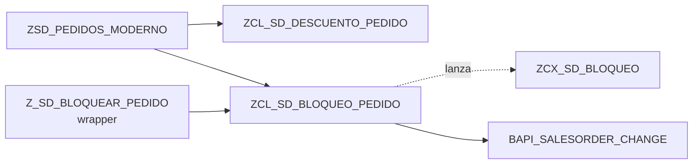

# SAP: práctica de modernización de código ABAP legacy

Ejercicio de modernización en tres etapas sobre objetos Z del módulo SD (Ventas): un reporte de pedidos con descuento y validación de crédito, y un módulo de función que bloquea la facturación del pedido.

El código legacy es **intencionalmente defectuoso**. Está escrito para practicar entendimiento, documentación y modernización. No es código de producción.

> **Estado:** nada de este código se ha compilado, activado ni ejecutado en un sistema SAP. Las pruebas ABAP Unit existen pero no se han corrido.

---

## Estructura

```
.
├── README.md                      Este archivo
├── ZSD_PEDIDOS_LEGACY.abap        1. Reporte legacy
├── Z_SD_BLOQUEAR_PEDIDO.abap      1. Módulo de función legacy
├── DOCUMENTO_ENTENDIMIENTO.md     2. Análisis del legacy
└── modernizacion/                 3. Versión modernizada
    ├── MODERNIZACION.md
    ├── zcx_sd_bloqueo.clas.abap
    ├── zcl_sd_descuento_pedido.clas.abap
    ├── zcl_sd_descuento_pedido.clas.testclasses.abap
    ├── zcl_sd_bloqueo_pedido.clas.abap
    ├── zcl_sd_bloqueo_pedido.clas.testclasses.abap
    ├── z_sd_bloquear_pedido.func.abap
    └── zsd_pedidos_moderno.prog.abap
```

---

## Etapa 1: código legacy

| Archivo | Objeto | Qué hace |
|---|---|---|
| [`ZSD_PEDIDOS_LEGACY.abap`](ZSD_PEDIDOS_LEGACY.abap) | Reporte | Lee pedidos (`VBAK`), calcula descuento por reglas hardcodeadas, valida crédito (`KNKK`) y opcionalmente sobrescribe `VBAK-NETWR` |
| [`Z_SD_BLOQUEAR_PEDIDO.abap`](Z_SD_BLOQUEAR_PEDIDO.abap) | Módulo de función | Pone un bloqueo de facturación al pedido, lo registra en `ZSD_BLOQ_LOG` y llama a `Z_SD_NOTIFICAR_BLOQUEO` |

Defectos típicos incluidos, entre otros: sintaxis obsoleta (`TABLES`, `OCCURS`, `HEADER LINE`), `SELECT *` dentro de loops, `UPDATE` directo a tablas estándar, `COMMIT WORK` dentro de loops y funciones, sin `AUTHORITY-CHECK`, sin `ENQUEUE`, `IF` anidados con valores mágicos, un backdoor por nombre de usuario y un `CASE` sin `WHEN OTHERS`.

## Etapa 2: documento de entendimiento

[`DOCUMENTO_ENTENDIMIENTO.md`](DOCUMENTO_ENTENDIMIENTO.md) es la línea base previa a modernizar. Contiene:

- Inventario de objetos y tablas SAP utilizados.
- 7 diagramas mermaid: arquitectura, flujo del reporte, árbol de descuentos, secuencia del módulo de función y modelos entidad-relación.
- 9 reglas de negocio detectadas (RN-01 a RN-09).
- 20 hallazgos (H-01 a H-20) con severidad, línea e impacto.
- Preguntas abiertas sobre objetos que no están en el repo.
- 11 pruebas de caracterización sugeridas (T-01 a T-11).

Las afirmaciones que dependen del comportamiento real de ABAP están marcadas como **[Hipótesis]**.

## Etapa 3: modernización

[`modernizacion/MODERNIZACION.md`](modernizacion/MODERNIZACION.md) mapea cada hallazgo a su corrección y lista los cambios de comportamiento.

| Objeto | Archivo | Reemplaza |
|---|---|---|
| `ZCX_SD_BLOQUEO` | [`zcx_sd_bloqueo.clas.abap`](modernizacion/zcx_sd_bloqueo.clas.abap) | `MESSAGE ... RAISING` y `sy-subrc` sin validar |
| `ZCL_SD_DESCUENTO_PEDIDO` | [`zcl_sd_descuento_pedido.clas.abap`](modernizacion/zcl_sd_descuento_pedido.clas.abap) | Los `IF` anidados del descuento (lógica pura, con 14 pruebas ABAP Unit) |
| `ZCL_SD_BLOQUEO_PEDIDO` | [`zcl_sd_bloqueo_pedido.clas.abap`](modernizacion/zcl_sd_bloqueo_pedido.clas.abap) | La lógica interna del módulo de función (usa `BAPI_SALESORDER_CHANGE`) |
| `Z_SD_BLOQUEAR_PEDIDO` | [`z_sd_bloquear_pedido.func.abap`](modernizacion/z_sd_bloquear_pedido.func.abap) | Queda como wrapper de compatibilidad |
| `ZSD_PEDIDOS_MODERNO` | [`zsd_pedidos_moderno.prog.abap`](modernizacion/zsd_pedidos_moderno.prog.abap) | El reporte legacy |



### La modernización no es equivalente 1:1 al legacy

Cambios que requieren confirmación de negocio antes de producción:

- El reporte ya no sobrescribe `VBAK-NETWR` (se quitó `p_upd`).
- Un cliente sin registro en `KNKK` ya no hereda el límite del cliente anterior.
- La marca de descuento alto ahora funciona. Antes probablemente nunca se activaba.
- Un motivo de bloqueo inválido lanza excepción en lugar de desbloquear el pedido.
- Se añaden autorizaciones por organización de ventas y se elimina el backdoor de `JPEREZ` y `DDIC`.

### Deuda que sigue abierta

- Clientes preferenciales, tipos de documento y porcentajes siguen en código (el siguiente paso sería una tabla de customizing).
- Los umbrales de descuento no tienen conversión de moneda.
- El bloqueo concurrente se delega en el BAPI y no está verificado.
- El bloqueo con BAPI y log, y el reporte completo, no tienen pruebas.

---

## Objetos que el código usa pero no están en el repo

La modernización depende de estos supuestos, deducidos del legacy:

| Objeto | Supuesto |
|---|---|
| `ZSD_BLOQ_LOG` | Campos `VBELN`, `DATUM`, `UZEIT`, `UNAME`, `MOTIV`, `TEXTO`. El orden se dedujo del `INSERT` legacy, los nombres no |
| `Z_SD_NOTIFICAR_BLOQUEO` | Acepta `I_VBELN` e `I_TEXTO` |
| Mensaje `ZSD` 001 | Existe |
| Valores `FAKSK` `01`, `02`, `10` | Existen en la configuración de bloqueos de facturación |

Si alguno falla, el código no compila o el BAPI devuelve error. Detalle en la sección 5 de [`MODERNIZACION.md`](modernizacion/MODERNIZACION.md).

---

## Requisitos

- Sistema SAP con ABAP 7.50 o superior (SQL con `@`, `COND`, `VALUE`, `xsdbool`).
- Módulo SD configurado, con control de crédito (`KNKK`).
- Para activar y probar: ADT en Eclipse o SE80, ATC y ABAP Unit.

Orden de activación sugerido:

1. `ZCX_SD_BLOQUEO`
2. `ZCL_SD_DESCUENTO_PEDIDO`
3. `ZCL_SD_BLOQUEO_PEDIDO`
4. `Z_SD_BLOQUEAR_PEDIDO`
5. `ZSD_PEDIDOS_MODERNO`

Los archivos `.abap` siguen la convención de nombres de abapGit. Son una referencia de lectura y no se importan directamente a un sistema: el repo no incluye los metadatos XML que abapGit necesita para importarlos.
