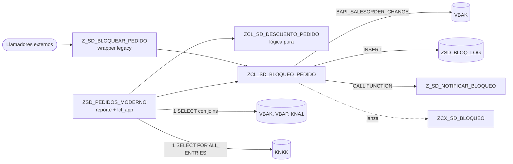

# Modernización: pedidos y bloqueo de crédito

Reemplazo de `ZSD_PEDIDOS_LEGACY` y `Z_SD_BLOQUEAR_PEDIDO`. Los IDs H-xx y T-xx remiten a [`DOCUMENTO_ENTENDIMIENTO.md`](../DOCUMENTO_ENTENDIMIENTO.md).

> **Estado:** el código **no se ha compilado, activado ni ejecutado** en un sistema SAP, y las pruebas ABAP Unit **no se han corrido**. Requiere revisión con ATC y una pasada en un sistema de desarrollo antes de transportar. Es ABAP 7.50 o superior (SQL con `@`, `COND`, `VALUE`, `xsdbool`).

---

## 1. Objetos

| Objeto | Archivo | Reemplaza |
|---|---|---|
| `ZCX_SD_BLOQUEO` | [`zcx_sd_bloqueo.clas.abap`](zcx_sd_bloqueo.clas.abap) | `MESSAGE ... RAISING` y `sy-subrc` sin validar |
| `ZCL_SD_DESCUENTO_PEDIDO` | [`zcl_sd_descuento_pedido.clas.abap`](zcl_sd_descuento_pedido.clas.abap) y [`.testclasses`](zcl_sd_descuento_pedido.clas.testclasses.abap) | Bloque de `IF` anidados de `FORM procesar` |
| `ZCL_SD_BLOQUEO_PEDIDO` | [`zcl_sd_bloqueo_pedido.clas.abap`](zcl_sd_bloqueo_pedido.clas.abap) y [`.testclasses`](zcl_sd_bloqueo_pedido.clas.testclasses.abap) | Lógica interna del módulo de función |
| `Z_SD_BLOQUEAR_PEDIDO` | [`z_sd_bloquear_pedido.func.abap`](z_sd_bloquear_pedido.func.abap) | Se conserva como **wrapper** de compatibilidad |
| `ZSD_PEDIDOS_MODERNO` | [`zsd_pedidos_moderno.prog.abap`](zsd_pedidos_moderno.prog.abap) | `ZSD_PEDIDOS_LEGACY` |

---

## 2. Mapeo de hallazgos

| ID | Estado | Cómo se resolvió |
|---|---|---|
| H-01 | Resuelto, **con cambio de comportamiento** (ver 3.1) | Se eliminó el `UPDATE vbak SET netwr` y el parámetro `p_upd` |
| H-02 | Resuelto | `AUTHORITY-CHECK` sobre `V_VBAK_VKO` (actividad 03 para listar, 02 para bloquear) |
| H-03 | Resuelto, **con cambio de comportamiento** | Un cliente sin registro en `KNKK` no se bloquea y queda con estado `SIN REGISTRO DE CREDITO` |
| H-04 | Resuelto | Parámetro `p_kkber` (área de control de crédito) en lugar de reutilizar `p_vkorg` |
| H-05, H-08 | Resuelto | Un solo `SELECT` con `LEFT OUTER JOIN` sobre `VBAP` y `KNA1`, y una lectura de `KNKK` con `FOR ALL ENTRIES` |
| H-06 | Resuelto, **con cambio de comportamiento** (ver 3.3) | Comparación numérica en `es_descuento_alto` |
| H-07 | Resuelto | `es_descuento_alto` devuelve `abap_false` si el total es 0 |
| H-09 | **Parcial** | Reglas aisladas en clase testeable. Clientes, tipos de documento y porcentajes **siguen en código** (ver 4) |
| H-10 | **No resuelto** | Los umbrales siguen sin conversión de moneda. Requiere definición de negocio (ver 4) |
| H-11 | Resuelto | Sin `TABLES`, `OCCURS`, `HEADER LINE` ni `LIKE`. Tipos de diccionario y tablas internas modernas |
| H-12 | Resuelto por eliminación | El contador era código muerto (variables locales). Se eliminó |
| H-13 | Resuelto | Sin backdoor |
| H-14 | **Delegado, sin verificar** | `BAPI_SALESORDER_CHANGE` debe tomar el bloqueo estándar del pedido. Hay que confirmarlo en pruebas con dos sesiones |
| H-15 | Resuelto | La clase no hace `UPDATE` directo ni `COMMIT`. El commit lo decide el llamador |
| H-16 | Resuelto, **con cambio de comportamiento** | Un motivo inválido lanza `ZCX_SD_BLOQUEO` y no toca el pedido |
| H-17 | Resuelto | Se valida `sy-subrc` del `INSERT` y se lanza excepción |
| H-18 | Resuelto | Guarda de reentrada `gv_notificando`: una llamada de vuelta desde la notificación se ignora antes de tocar datos |
| H-19 | Resuelto | El reporte captura `ZCX_SD_BLOQUEO` por pedido y sigue con el siguiente. El wrapper conserva `MESSAGE ... RAISING no_encontrado` para llamadores antiguos |
| H-20 | Resuelto | Se eliminó `tvlv` |

---

## 3. Cambios de comportamiento que requieren confirmación de negocio

La modernización **no es equivalente 1:1** al legacy. Estos puntos cambian resultados y hay que validarlos antes de pasar a producción.

### 3.1 El reporte ya no escribe `VBAK-NETWR`
El legacy, con `p_upd = X`, sobrescribía el valor neto del pedido con el neto descontado. Eso es una escritura directa sobre una tabla estándar, fuera de la lógica de precios. En el nuevo reporte **ese parámetro no existe** y el neto descontado solo se muestra.

**Decisión pendiente:** si el negocio necesita persistir el descuento, debe hacerse con una condición de precio vía `BAPI_SALESORDER_CHANGE`, no con `UPDATE`.

### 3.2 Crédito
- Un cliente sin `KNKK` ya no se evalúa con el límite del cliente anterior (H-03).
- Las áreas de control de crédito se filtran con `p_kkber`. Si en el legacy funcionaba porque `p_vkorg` coincidía con `KKBER`, hay que revisar el valor por defecto de `p_kkber` (`1000`) y las variantes guardadas.

### 3.3 La marca de descuento alto
Según la hipótesis H-06 del documento de entendimiento, la comparación del legacy era de texto y la marca probablemente **nunca se activaba**. Ahora funciona, así que aparecerán pedidos con `DESC ALTO` que antes no aparecían. En la práctica, con las reglas actuales, solo los clientes preferenciales (15 %) superan el 12 %.

### 3.4 Seguridad
- Los pedidos de organizaciones de ventas sin autorización de visualización **se excluyen** del reporte (se informa cuántos).
- Si el usuario puede ver el pedido pero no tiene actividad 02 (cambiar), el pedido queda con estado `EXCEDE CREDITO - SIN AUTORIZACION PARA BLOQUEAR`.
- Los usuarios `JPEREZ` y `DDIC` ya no están exentos del bloqueo.

### 3.5 Transacciones
Cada pedido se confirma o se revierte por separado (`BAPI_TRANSACTION_COMMIT` / `ROLLBACK`). Un fallo en un pedido no revierte los anteriores. El estado de cada pedido queda visible en la columna `ESTADO`.

### 3.6 Interfaz del módulo de función
- Nueva excepción `ERROR_BLOQUEO` (motivo inválido, error del BAPI o del log).
- `I_MOTIV` pasa de `C` sin longitud a `CHAR2`.
- Los llamadores que no declaren `EXCEPTIONS error_bloqueo` terminarán con error de ejecución si ocurre. Antes esos casos pasaban sin avisar.

### 3.7 El estado `BLOQUEADO` ya no es falso
El legacy marcaba `BLOQUEADO` aunque el módulo hubiera salido por el backdoor. Ahora el estado solo es `BLOQUEADO` si el bloqueo y el log se completaron. Si la notificación falla, queda como `BLOQUEADO (notificacion fallida)`.

---

## 4. Deuda que queda abierta

| Tema | Detalle | Siguiente paso sugerido |
|---|---|---|
| Reglas hardcodeadas | Clientes preferenciales, tipos de documento, porcentajes y umbrales siguen en `zcl_sd_descuento_pedido` | Tabla de customizing `ZSD_DESC_CFG` con mantenimiento por SM30 |
| Moneda | Se compara el total en `waerk` contra 100,000 y 50,000 sin convertir | Decidir moneda de referencia y convertir con una función estándar de conversión de moneda |
| `-2 %` en devoluciones | Se mantiene la regla (aumenta el neto) porque no hay evidencia de si es intencional | Confirmar con negocio. Si es un error, el cambio es una línea y una prueba |
| `Z_SD_NOTIFICAR_BLOQUEO` | Sigue sin verse su código. La guarda de reentrada cubre la recursión, pero no sabemos qué más hace | Revisar el objeto real |
| Pruebas con base de datos | Las pruebas ABAP Unit cubren solo lógica pura. `bloquear` (BAPI, log) y el reporte **no** tienen pruebas | Test doubles o `OSQL_TEST_ENVIRONMENT` sobre `VBAK` y `ZSD_BLOQ_LOG` |
| Retirar el wrapper | `Z_SD_BLOQUEAR_PEDIDO` sigue activo | Buscar usos con la lista de empleo (`where-used`) y migrar los llamadores a la clase |

---

## 5. Supuestos sobre objetos que no se vieron

El código depende de estos supuestos, deducidos del legacy:

| Supuesto | Dónde se usa | Si es falso |
|---|---|---|
| `ZSD_BLOQ_LOG` tiene los campos `VBELN`, `DATUM`, `UZEIT`, `UNAME`, `MOTIV`, `TEXTO` | `registrar_log` | No compila. Ajustar el `VALUE zsd_bloq_log(...)`. El orden se dedujo del `INSERT ... VALUES` del legacy, **los nombres no** |
| `Z_SD_NOTIFICAR_BLOQUEO` acepta `I_VBELN` e `I_TEXTO` | `notificar` | No compila |
| Mensaje `ZSD 001` existe | Wrapper | Mensaje vacío |
| `BAPISDH1-BILL_BLOCK` es el campo de bloqueo de facturación (`FAKSK`) | `aplicar_bloqueo` | Revisar en SE11 |
| Los valores `FAKSK` `01`, `02` y `10` existen en la configuración (`TVFS`) | `resolver_motivo` | El BAPI devolverá error |

---

## 6. Cómo validar

1. Activar en este orden: `ZCX_SD_BLOQUEO`, `ZCL_SD_DESCUENTO_PEDIDO`, `ZCL_SD_BLOQUEO_PEDIDO`, la función y el reporte.
2. Ejecutar ATC y las pruebas con `Ctrl+Shift+F10` (ADT) o `SE24`.
3. Pruebas de caracterización contra el legacy:

| Prueba | Cubierta por |
|---|---|
| T-01 a T-04 (descuentos) | ABAP Unit, ya incluidas |
| T-07 (motivo inválido) | ABAP Unit, ya incluida. **El resultado cambia a propósito** |
| T-05, T-06, T-10 | **Cambian a propósito** (3.2, 3.3, 3.7). Validar el nuevo comportamiento |
| T-08, T-09, T-11 | Manual en sistema de desarrollo |
| Bloqueo concurrente (H-14) | Manual, dos sesiones sobre el mismo pedido |

4. Ejecutar ambos reportes (legacy y nuevo) con `p_upd` desactivado sobre el mismo rango de pedidos y comparar descuento y neto.
